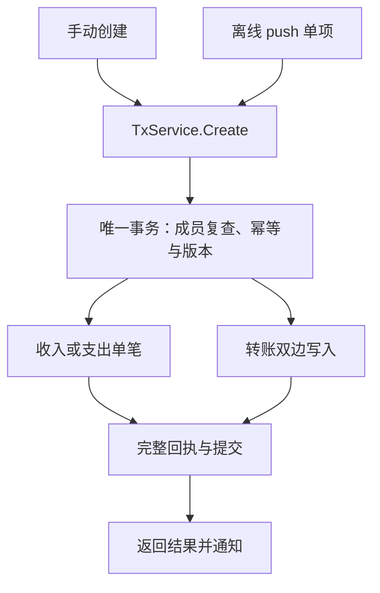

# FastLedger 转账入口裁决（GPT-ADR01）

日期：2026-10-29。对应审阅基线：`9a3a2e38a6476450b04fea59c9cb49eb5dba7416`。本裁决按项目方的明确请求作出，是《落地方案》§6.1 的技术细化，与《枚举字典》的正欠款规则一致。

## 1. 最终裁决

**唯一公开领域入口为 `TxService.Create(ctx, uid, bookID, CreateRequest) (*CreateResult, error)`。** 收入、支出、转账及离线补传的每个创建命令均进入该函数。

转账内部使用 `createTransferInTx(sess, ..., version)`；该 helper 接收外层已有事务及版本，不自己开启/提交事务，不再占幂等回执，不再递增版本。旧 `AddTransaction` 和独立可提交的 `Transfer` 退出有效骨架，历史源码仅供复核。

裁决依据：技术权威《落地方案》已有统一 Create；统一的幂等和事务边界能覆盖所有创建来源。v1.4 的双入口使 `AddTransaction(txType=3)` 产生一条无余额变化的记录，而独立 Transfer 才生成双边，两者不能并列作为最终实现。详见 GPT-R23。



## 2. HTTP、同步与返回值

| 项目 | 统一契约 |
|---|---|
| 手动创建 | `POST /api/v1/books/{bookID}/transactions`，三种类型共用 |
| 离线创建 | `sync/push` 每项调用同一个 Create；保留原稳定操作键 |
| 身份与账本 | uid 来自认证上下文，bookID 来自可信路径；请求 DTO 不接收覆盖字段 |
| 操作键 | JSON `clientUuid`，数据库 `client_uuid`；Handler 和 Service 双层必填校验 |
| 转出/转入 | `accountId` / `toAccountId`；必须不同、有效且同账本；MVP 不隐式换汇 |
| 金额与时间 | 正整数分；txTime 为请求发生时间，不能每次重试重新取当前时间 |
| 单笔返回 | 一个交易 ID、创建版本、resultType=1 |
| 转账返回 | `[outID,inID]`、创建版本、resultType=2 |
| 重试返回 | 同一组 ID 与原创建版本，replayed=true；不再修改余额和版本 |
| 通知 | 提交后发送带 bookId/version 的失效通知，明细经授权 pull |

转账示例：

```json
{
  "clientUuid": "59c921d1-58cc-48d8-a5ae-1e870ae71fc2",
  "txType": 3,
  "accountId": 1,
  "toAccountId": 2,
  "amount": 10000,
  "txTime": 1793260800,
  "comment": "信用卡还款"
}
```

缺键/非法命令为 400，同键不同内容或操作类型为 409，成员权限不足为 403；数据库错误由适配层映射统一 5xx/可重试错误，不能把原始 SQL 直接展示给用户。其他资源的修改/删除需按各自操作语义建立幂等规则，本裁决的可执行核验范围是交易创建。

## 3. 幂等回执必须完整

1. 同一写事务内插入回执占位，唯一键为 `(book_id,uid,client_uuid)`；result_type 不加入唯一键。
2. 仅针对该唯一键使用 `ON CONFLICT ... DO NOTHING`。其他数据库错误直接失败并回滚，禁止 `if err != nil { return nil }`。
3. 同键命中后同时核对操作类型与完整规范化请求摘要；不完整回执不是成功。
4. 新操作只取一个版本，写全部业务实体和账户版本，再回写 `result_ids/result_version`。回写失败或影响行数错误应回滚整笔。
5. 提交成功才返回结果；重试读取持久化的 ID 和创建版本。瞬时锁错误按原键重试整个命令，不能从中途续跑。

请求摘要统一为带 `transaction.create/v1` 域标签的完整 `CreateRequest` 的确定性编码，排除操作键和服务端生成字段。分类、渠道、备注、时间等已接受的业务字段全部参与。分成两个命名 hash 函数本身不构成安全保证；v1.4 的 requestHash 确实漏了分类与渠道，见 GPT-R20。

回执 `result_type` 与 `result_version` 契约见《枚举字典》§12。MVP 不自动清理仍可能被重放的回执；后续保留策略必须先明确离线重试窗口。

## 4. 余额、版本与双边原子性

| 账户类别 | 转出余额增量 | 转入余额增量 |
|---|---:|---:|
| 资产 1–9 | −amount | +amount |
| 负债 10–15（正=欠款） | +amount | −amount |

保证的是净资产贡献相抵。储蓄卡还信用卡时两个存储余额都减少；不能把“原始余额一减一增”写成所有转账的硬规则。

两条关联交易、两侧账户与回执在同一事务内成功或回滚。交易和账户写同一版本，发生时间从命令传入，整数运算需检查溢出和影响行数。转账方向的长期存储及删除/恢复服务仍须在正式工程中验收，本轮不宣称这些服务已经实现。

版本号唯一可调用实现为《落地方案》§6.1 的 `VersionRepo.Next`；其他写路径通过 `VersionSource` 依赖它。旧 nextBookVersion 实现退出当前骨架，§3.5 的 SQL 仅作算法解释。

## 5. 落地位置和验证边界

- 权威流程：《落地方案》§5.1/§6.1；可执行参考骨架：《新手开发完整指南》§13.1；接线/迁移约束：§13.2。
- 历史问题继续用 GPT-R03、GPT-R06、GPT-R16，不重排或换号；新增发现 GPT-R19–GPT-R23 的完整字段见 `gpt/v1.4/findings.json`。
- 真实 Go/xorm/SQLite 核验、故障注入及 Hub 核心 race 结果见 `gpt/v1.4/verification/runtime-results.json`。测试为文档片段隔离核验，正式 Gin 接线、真实 WS 生命周期、Flutter、端到端权限与同步仍待正式工程完成。

禁止用“文档已有函数/回执表”代替运行证据，也不能把隔离样例编译通过描述为整个应用已经可运行。
